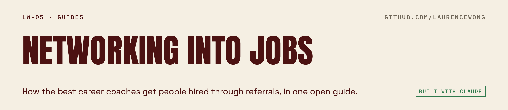

<picture>
  <source media="(prefers-color-scheme: dark)" srcset=".github/assets/lw05-dark.png">
  
</picture>

# Networking Into Jobs

A practical guide to getting hired through referrals and warm introductions instead of cold job applications. Written for a senior product manager, but the process works for most knowledge-work roles.

This pulls together public, free teaching from several career coaches and career-services offices into one process. It credits each idea to the person who popularized it. It does not reproduce anyone's book, course, or template word for word. Where a source makes a claim or cites a statistic, that is attributed to them, not presented as independently verified fact. See `SOURCES.md` for the full list and `templates/` for ready-to-use message drafts.

## Why referrals beat applications

Cold applications compete against an applicant-tracking system and a stack of hundreds of resumes. A referral or a warm introduction gets your resume in front of a person instead of a filter, and it comes with implied vouching.

Austin Belcak, who runs the career site Cultivated Culture, cites a Wall Street Journal estimate that 80% of hires come through referrals and a lower Jobvite estimate of 40%. Treat both as industry color, not precise measurement. Nobody tracks this cleanly across the whole job market. What matters more than the exact number is the mechanism. A referral replaces a resume screen with a conversation.

Jeff Su, a YouTube creator who covers career tactics, makes the mechanism explicit by pointing to Mark Granovetter's sociology research on "the strength of weak ties." His claim, in his own words, is that loose acquaintances (not your close friends) are the ones most likely to lead you to a job, because they sit in a different part of the network and surface different opportunities. The exact figure he cites (84%) comes from his video, not from a figure this guide independently verified against Granovetter's original paper. The underlying idea, that your second-degree network matters more than your first-degree network, is the useful takeaway.

## The shape of the process

Strip away each coach's branding and the same four phases show up everywhere: build a target list, find the right people, start a real conversation, and convert that conversation into an introduction or a referral. Steve Dalton (author of *The 2-Hour Job Search* and a career director at Duke's Fuqua School of Business) calls his three stages Prioritize, Contact, and Convince. Phyl Terry (author of *Never Search Alone*) calls his three big ideas the Job Search Council, Candidate-Market Fit, and Play-to-Win-Win. Different vocabulary, same arc. The five steps below map onto both.

1. Build a target list
2. Find the right contacts
3. Reach out
4. Have the conversation and ask for a referral
5. Follow up and track everything

## Step 1: Build a target list

Start with companies and roles, not individual contacts. Trying to network broadly without a target list is how you end up with thirty shallow LinkedIn connections and no real leads.

Dalton's method, which he calls LAMP, is the most rigorous public version of this step. In his own teaching, he has job seekers spend about 70 minutes building a list of roughly 40 target employers from four sources (companies you already admire, your school's alumni database, active job postings, and companies mentioned in industry news), then score each one on a simple scale for personal motivation. He sorts the finished list by that gut-feel motivation score first, then by whether jobs are actively posted there, then by whether you have an alumni connection. The point of scoring is to avoid what Dalton calls "artificial desperation," which means fixating on two or three employers and burning out your network on them before you've tested whether they're actually a fit.

J.T. O'Donnell, who runs the coaching site Work It Daily, uses a looser version she calls a "bucket list" of target companies, then has clients identify 5 to 10 people at each one in the department or role they want. You don't need Dalton's exact scoring system to get the benefit. Both of them share the same underlying principle. Pick more targets than feels necessary, so no single company gets all the pressure.

Before you touch outreach, Phyl Terry adds a step most tactical guides skip. Figure out what you're actually suited for before you start contacting people about it. He calls this a "listening tour," going to people who already know your work and asking them what kind of role they'd point you toward, rather than guessing on your own. It's a useful gut check if your target list feels scattered or you're pivoting functions.

## Step 2: Find the right contacts

Your own alumni network is underused. Jeff Su points out that most university LinkedIn pages have an "Alumni" tab with a search filter, and the same filter exists on a company's own "People" tab on LinkedIn. You can search by job title to find people more senior in your target function, or by company name plus function to find alumni at a specific target employer. Career offices build the same thing from the other direction. Stanford's career center runs a formal alumni mentoring network it says has over 10,000 volunteers, and Harvard's runs a similar advisor platform with over 3,500 alumni. If you went to a university with a career office, check whether it runs something similar before assuming you have no path in.

Madeline Mann, who runs the channel Self Made Millennial, adds a step before you message anyone cold. Comment on their public posts or content first, so your name is familiar when your connection request shows up. Belcak frames the same idea as leading with small, low-effort value (a comment, a share) before any ask.

Belcak and Dalton share a practical note here. Once you've identified a target person, a free email-finder tool (Belcak names Mailscoop) can get you a direct email address if LinkedIn messaging isn't available or you'd rather not burn a connection request.

## Step 3: Reach out

Three separate sources, working independently (Belcak, Mann, and Su), converge on almost the same three types of opening line for a cold message. That convergence is worth paying attention to:

- **Something specific about them.** A real detail from their profile, a post they wrote, or a career move, not a generic compliment. Mann calls this "the compliment," Belcak calls it part of his "value equation," Su calls it one of his "three elements."
- **A real point in common.** Same school, same past employer, same city, a shared connection you're confident they actually know.
- **Something you can offer them**, even something small: a relevant article, an introduction, a piece of feedback on something they posted.

Mann calls the same move "this-or-that." Instead of "can I pick your brain," ask something like "do you think it's better to go agency-side first or in-house first?" A question with two visible options is far easier to answer from a phone than an open-ended one. Belcak recommends phrasing your first ask the same way, close to an A-or-B question, so the reply can be one line.

Don't ask for a job in the first message. Every career-services guide this research touched (Harvard, Stanford, Berkeley) treats this as close to a hard rule. State plainly that you're looking for information or perspective, not a referral, in the first contact. The ask for help with the job itself comes later, after a real conversation.

For a cold outreach where you have no connection to lean on, Su's sequence for reaching a recruiter is a useful fallback. Connect first without mentioning the role, and only after they accept, ask whether they can connect you to someone actually doing the job for "a casual chat." It's a slower path than a warm intro, but it still gets you to a person instead of an application form.

## Step 4: The conversation

Once someone agrees to talk, keep it short and keep your word on the length. Most of the guides researched here land in the same narrow band: Belcak caps it at 30 minutes, Stanford and Berkeley both suggest 20 to 30 minutes, and O'Donnell suggests you can get real value out of as little as 10 to 15 minutes. State the time you're asking for up front and don't run over it unless they offer to keep going.

Come with questions, not a pitch. Su organizes his question list into three buckets: what the job actually involves day to day, how the person's own career path unfolded, and what's happening in the industry that you should know about. He specifically recommends swapping the generic "what's your day-to-day like" for something sharper, like asking how their performance is actually measured, since it gets a more concrete answer.

O'Donnell suggests opening with one easy, low-stakes question (something like what drew them to the role) before getting into anything deeper. The goal of the easy opener is just to get the conversation moving without putting the other person on the spot.

A few practical notes showed up consistently. Research the person and the company before the call so you're not asking anything they could Google for you (Harvard, Stanford, Berkeley, and Belcak all say this explicitly), and bring more questions than you'll need. Stanford suggests 5 to 7 for a 30-minute call. Harvard suggests up to 15.

## Step 5: Asking for a referral without being awkward

The single highest-leverage move in the whole process, according to Su, is a closing question at the end of every conversation. Something close to "is there anyone else you think I should talk to?" He frames it as the question that compounds your network outward, call by call. Harvard's and Stanford's own guides land on nearly identical phrasing independently, which suggests this specific ask has become a standard across career-services teaching, not something any one person invented.

If you're asking a contact to help with a specific role they have influence over, rather than another introduction, there's a softer way in than asking directly for a referral. O'Donnell's advice is to ask for their advice on how to stand out with the hiring manager, not for the referral itself. Often the person offers to make the introduction unprompted once they've given you advice, because it's the natural next thing to offer. Berkeley's career center frames the same idea with a useful image. Think of asking for a referral like asking for directions, not asking for a ride. You're asking someone to point you somewhere, not to personally carry you there.

If someone says no, or doesn't have a formal way to refer you, don't push. Berkeley's guide suggests falling back to "do you have any advice on how I could strengthen my candidacy," which keeps the relationship intact and often produces something just as useful.

## Follow-up and tracking

Most people who network give up after one message. The follow-up is where the process actually separates from everyone else trying the same tactics.

Dalton's system here, which he calls the 3B7 Routine, is the most specific. The moment you send a first outreach message, set two calendar reminders, one at 3 business days and one at 7 business days. His reasoning is that response likelihood drops sharply after the third business day, so the first reminder tells you to move on to the next person on your list in parallel rather than wait. The second reminder, at day 7, is a quieter second touch that costs you nothing and differentiates you from everyone who sent one message and gave up.

After an actual conversation, the follow-up window tightens. Mann, Stanford, and Berkeley all land close together here. Send a thank-you within 24 to 48 hours. Harvard's guide extends the patience window slightly further for a cold ask that hasn't been answered at all. Follow up once more after about a week, then let it go after two attempts with no response.

The follow-up matters beyond etiquette. Both Mann and Su point out that circling back later to report what happened when you acted on someone's advice reopens the relationship and often leads to a second, deeper conversation, sometimes the referral itself.

Track every contact somewhere outside your head. Harvard's career office is explicit about this: a simple spreadsheet with name, title, company, how you reached them, and what happened next. At a minimum, track: who, when you reached out, when you followed up, whether you talked, what they said, and what you promised to do next (send your resume, report back on advice, make an introduction). A spreadsheet is enough. Don't rely on memory for whose turn it is to follow up.

## A weekly cadence

None of the sources above prescribe an exact weekly quota, so this is an original recommendation built from the pieces above, sized for someone employed full time and job searching on the side.

- **Monday:** Review your target list. Add or drop two to three companies based on what you learned the prior week. Identify 5 to 10 new contacts across your top targets.
- **Tuesday to Thursday:** Send 3 to 5 new first-contact messages, spread across the week rather than batched in one sitting. Each one personalized, none copy-pasted verbatim.
- **Ongoing, daily 10 minutes:** Check your tracker for anyone due for a 3-day or 7-day follow-up (Dalton's 3B7 cadence) and send those.
- **As calls land:** Take them, send the thank-you within 48 hours, and log what you learned and what you owe (a resource, a report-back, an intro you offered).
- **Friday:** Update the tracker. Note which conversations are due for a report-back follow-up in 2 to 4 weeks (when you've actually acted on advice someone gave you).

A realistic senior-level search runs 5 to 10 active conversations at any time, not 50 contacts fired off in one week.

## Common mistakes

- **Asking for a job in the first message.** Every career-services source here treats this as disqualifying. Lead with curiosity, not an ask.
- **Sending the same message to everyone.** Mann and O'Donnell both flag generic, unpersonalized LinkedIn invites as something recipients recognize instantly and ignore.
- **Only talking to a handful of companies.** This is Dalton's "artificial desperation" risk. When your whole search rides on two employers, every interaction carries too much weight and it shows.
- **Giving nothing before you ask for something.** Belcak's "value equation" is really just reciprocity. Comment on their work, share something useful, before you ask them for their time.
- **Never asking the closing question.** Su calls this the single biggest miss, ending a good conversation without asking who else you should talk to.
- **Letting the thread go cold.** Most job seekers message once and stop. Dalton's entire 3B7 system exists because that's the default failure mode, not an edge case.
- **Treating the informational conversation as a job interview.** If you pitch yourself the whole time instead of asking questions, you've turned a low-pressure conversation into exactly the kind of interaction people avoid taking.

## How an AI assistant can help

An assistant is useful for the mechanical parts of this process and should stay out of the parts that require a real human voice.

Useful, appropriate uses:
- **Building and maintaining the target list.** Pulling company names from job boards, news, and alumni directories into one list, and helping you score and sort it the way Dalton's LAMP method does.
- **Drafting outreach in your own voice.** A first draft of a message based on a real detail you give it about the recipient, which you then edit until it sounds like you, not like a template.
- **Running the tracker.** Logging who you've contacted, when you're due to follow up, and what each conversation produced, so nothing falls through.
- **Follow-up reminders.** Surfacing who's due for a 3-day, 7-day, or report-back follow-up, the same role Dalton's calendar reminders play, just automated.

One rule matters most: **the person sends every message themselves.** No automated mass outreach, no bot sending connection requests or DMs on your behalf, and no mail-merge blast to a list of contacts. Every message that reaches another human should be one that person chose to send, in their own words. The whole point of this process is that it works precisely because it isn't mass outreach.

## Go deeper

What follows draws on the free, public teaching of the people below. If one of their frameworks resonated more than the others, go to the source directly. Listed in neutral order, not ranked.

**Steve Dalton** teaches the most structured, numbers-driven version of this process (a scored target list, a fixed follow-up cadence). Best for someone who wants a literal, repeatable system rather than general advice, especially MBA students and early-career job seekers.
Free content: articles at 2hourjobsearch.com/articles. Book: *The 2-Hour Job Search* (and a follow-up, *The Job Closer*, on resumes and interview answers).

**J.T. O'Donnell** teaches a conversational, script-heavy version built around LinkedIn outreach and a chain of informational interviews. Good fit if you want exact wording to copy and adapt for LinkedIn messages.
Free content: the Work It Daily YouTube channel ("Just Ask JT" series) and the free resource center at workitdaily.com.

**Austin Belcak** teaches a template- and tools-heavy version aimed at treating your job search like a small marketing effort. Best for someone who wants ready-made cold email templates and a system for prioritizing which companies to approach.
Free content: the articles section at cultivatedculture.com.

**Madeline Mann** teaches networking and informational-interview scripts from a former-recruiter, HR-insider angle. Pick this one if you want to understand how the message lands on the other side of the screen.
Free content: the Self Made Millennial YouTube channel.

**Phyl Terry** teaches a peer-group, community-based version of job searching built around small accountability groups rather than individual tactics. Works well if you want structure and emotional support through a longer search, rather than scripts alone.
Free content: neversearchalone.org (including a free downloads section), LinkedIn posts, and live events. Book: *Never Search Alone*.

**Jeff Su** teaches concrete LinkedIn mechanics: exactly which filters to use, what to say, and how to structure an informational-interview question list. Best for someone who wants step-by-step tactical video walkthroughs.
Free content: the Jeff Su YouTube channel and his newsletter at jeffsu.org.

**Lenny Rachitsky** covers job search specifically for product managers and adjacent tech roles, both in his own writing and through interviews with people like Phyl Terry. Good fit for a PM-specific audience who wants the broader hiring-market context alongside the tactics.
Free content: lennysnewsletter.com (many posts are free) and Lenny's Podcast on YouTube.

**University career centers** (several, including Harvard, Stanford, and Berkeley, publish free guides) independently teach very similar informational-interview scripts and etiquette, which is itself useful signal that this isn't one person's invented framework. Best for anyone who still has access to their own school's career center. Check your alma mater's career services site for an informational-interview guide and an alumni mentoring network before assuming you have no formal path in.

See `SOURCES.md` for the specific pieces this guide drew from, with links.

## Playbook

This guide is the why: the shape of the process and the reasoning behind each step. `PLAYBOOK.md` is the how, situation by situation: a worked example and a do/avoid for 17 specific moments you'll actually hit (an ex-colleague at the target company, a recruiter who went quiet, the referral ask after a good call, someone offering a referral before you ask, what to do if you're still employed when someone asks what you're working on), plus the call script, a weekly cadence with target reply rates, and a pre-send checklist. Start here for the method, go to `PLAYBOOK.md` when you're about to write an actual message.
